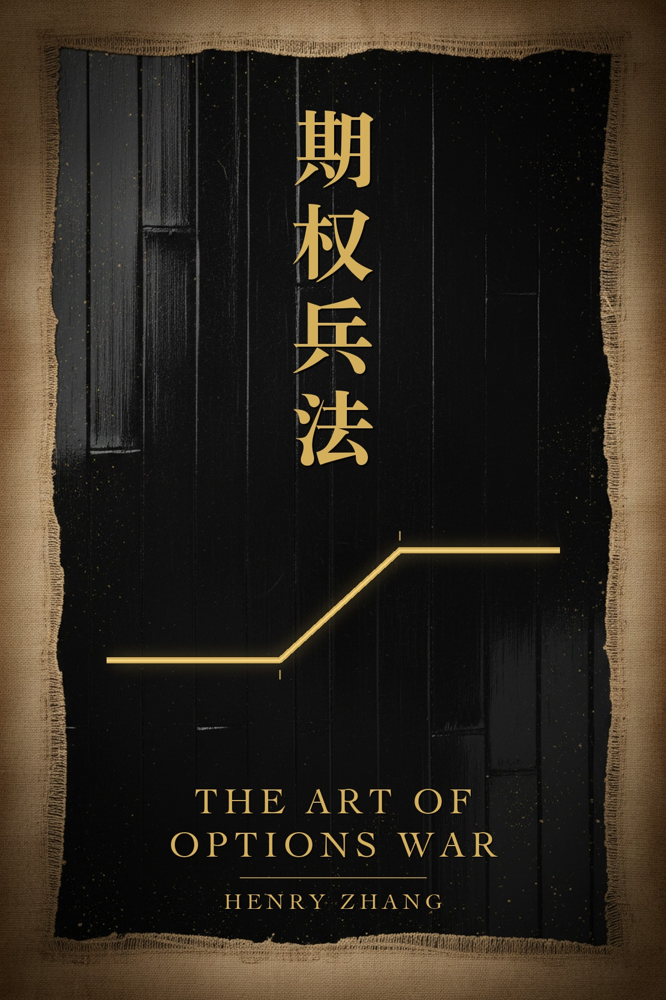

# The Art of Options War · 期权兵法

**Sun Tzu's thirteen chapters, in his order and on his subjects, read from both ends of a defined-risk options ticket, the seller of the credit spread and the buyer of the option, and a fifth part on the general's own question: when to defend, and when to attack.**

*Second edition.* It absorbs two companion books, *The Options Underwriter* and *The Counted Trade*. The seller now reads the spread as an insurer reads a policy, and the buyer carries the Thirty-Six Stratagems, which stand whole in an appendix.

Two and a half thousand years ago a general wrote thirteen short chapters on how to win without being destroyed. He was not interested in glory. He was interested in the arithmetic of survival: which battles to fight, which to refuse, how to be paid by an enemy's mistakes instead of your own courage, and why the state that wins every battle can still lose the war.

Options are the same problem in a different uniform, and the uniform has two sides. The seller is paid to hold a line. He does not need to know where the enemy will go, only where the enemy will not arrive in time. He wins most engagements and can be ruined by one. The buyer pays for the right to be right. He loses most engagements, each one small and paid for in advance, and lives on the rare one that pays many times over.

Every chapter reads the general twice. **The Seller** comes first: the credit spread, the hedge into a condor, the short leg cut and the wing kept. **The Buyer** follows: the debit as the whole risk, time as the enemy, volatility as the price, the catalyst as the only ally, and five sentences to say before paying — the edge, the catalyst, the maximum loss, the time stop and the breakeven win rate. The commentary reads both.

Numbered aphorisms with a commentary, in the manner of the Giles translation. No forecasts, no signals, no performance claims.

Part V, *Attack and Defence* 《攻守》, comes after *Spies*, because a trader cannot choose a stance until he has read what the fire costs. In it the buyer speaks first: the two banks of one river, the five grounds of attack, the tax most attackers pay, buying as insurance, and when to change sides.

## Read it

| | English | 中文 |
|---|---|---|
| Contents | **[Start here](en/README.md)** | **[从这里开始](zh/README.md)** |
| One file | [The whole book](en/the-whole-book.md) | [全书单页](zh/the-whole-book.md) |
| Prologue | [Before the Temple Count](en/prologue.md) | [序：庙算之前](zh/prologue.md) |

### Or download the typeset edition

| | PDF | EPUB |
|---|---|---|
| English | [The Art of Options War.pdf](https://pub-aa4f5218b3ce4b3abd876680f0ff5545.r2.dev/books/art-of-options-war/The-Art-of-Options-War.pdf) | [.epub](https://pub-aa4f5218b3ce4b3abd876680f0ff5545.r2.dev/books/art-of-options-war/The-Art-of-Options-War.epub) |
| 中文 | [期权兵法.pdf](https://pub-aa4f5218b3ce4b3abd876680f0ff5545.r2.dev/books/art-of-options-war/%E6%9C%9F%E6%9D%83%E5%85%B5%E6%B3%95.pdf) | [.epub](https://pub-aa4f5218b3ce4b3abd876680f0ff5545.r2.dev/books/art-of-options-war/%E6%9C%9F%E6%9D%83%E5%85%B5%E6%B3%95.epub) |

These files are still the **first edition**; they will be rebuilt from this text when the second edition is released, and the first edition will stay downloadable from a release. Built from the same source as the repository, so the two cannot disagree. No
email required for any of it.

Both editions were written by hand. The Chinese is not a machine translation of the English, and the English is not a translation of the Chinese — they are the same book written twice. The 中文 second edition is complete; the Chinese of Part V (Chapters 14–18) is a first draft, still to be checked by the author.

Prefer to read it as a book? It's free in the [Henry Zhang Books app](https://apps.apple.com/app/id6792229566) too, with the English and 中文 toggle.

## The chapters

| | | | |
|---|---|---|---|
| **Part I — The Count** | 1. [Counting in the Temple](en/chapter-01.md) 《庙算》 | 2. [The Cost of the Campaign](en/chapter-02.md) 《作战》 | 3. [Winning Without Fighting](en/chapter-03.md) 《谋攻》 |
| **Part II — Shape and Force** | 4. [The Unbeatable Position](en/chapter-04.md) 《军形》 | 5. [Force and the Four Quarters](en/chapter-05.md) 《兵势》 | 6. [Weak Points and Strong](en/chapter-06.md) 《虚实》 |
| **Part III — The March** | 7. [Manoeuvring](en/chapter-07.md) 《军争》 | 8. [Variation](en/chapter-08.md) 《九变》 | 9. [The March](en/chapter-09.md) 《行军》 |
| **Part IV — Ground and Fire** | 10. [Terrain](en/chapter-10.md) 《地形》 | 11. [The Nine Situations](en/chapter-11.md) 《九地》 | 12. [Fire](en/chapter-12.md) 《火攻》 |
| | 13. [Spies](en/chapter-13.md) 《用间》 | | |
| **Part V — Attack and Defence** | 14. [The Two Banks](en/chapter-14.md) 《两岸》 | 15. [When to Attack](en/chapter-15.md) 《攻》 | 16. [The Attacker's Tax](en/chapter-16.md) 《攻者之税》 |
| | 17. [The Wing in the Baggage Train](en/chapter-17.md) 《辎重之翼》 | 18. [The Turn of the Wheel](en/chapter-18.md) 《攻守之轮》 | |
| **Appendices** | A. [The Thirty-Six Stratagems](en/appendix-a.md) 《三十六计》 | B. [The Underwriter's Ledger](en/appendix-b.md) | C. [Sources](en/appendix-c.md) |

The order is the argument: count before you fight, know what a campaign costs, win without needing to be right — or be right cheaply when you must be — make yourself unbeatable before you look for a chance, divide your force, read the ground, survive fire, value information above every other weapon, and only then choose whether today is a day to defend or to attack.

## Read one chapter a day

Then read them again in the general's order. Eighteen chapters, about two and a half weeks at one a day, and the second pass is where the order starts to do the work.

## A note on what this is

This book is education, not advice. It contains no recommendations for you personally, no signals and no promises. Options can lose money faster than stock. A defined-risk spread cannot lose more than its width, and a long option cannot lose more than its debit, but either can still be more than you can afford, and a run of them can still end an account. Nothing here is a performance claim; where the text names a number, the number is arithmetic you can check on paper.

## The author

Henry Zhang · 张恒 — [officialhenryzhang.com](https://www.officialhenryzhang.com) · [LinkedIn](https://www.linkedin.com/in/henryzhang99/) · [GitHub](https://github.com/henryzhangpku)

The ideas the commentary rests on are the ones I actually trade: size over frequency, one side first on a trend read, hedge into a condor only when hurt, cut the short leg and keep the wing; and on the buyer's side, a dated catalyst, a debit small enough to lose many times over, and a time stop as firm as any price stop.

- **Absorbed into this edition** — [The Options Underwriter · 期权承保](https://github.com/henryzhangpku/options-underwriter) and [The Counted Trade · 算而后战](https://github.com/henryzhangpku/the-counted-trade). Their first editions stay free where they are.
- **This book, on the reading app** — [Henry Zhang Books on the App Store](https://apps.apple.com/app/id6792229566), where it reads as a book with the bilingual toggle and the audiobook narration.
- **Notes and letters** — [henryzhang.substack.com](https://henryzhang.substack.com/)

## Corrections and translations

Corrections are welcome — open an issue or a pull request. If you find a place where the arithmetic in the commentary does not check out on paper, that is the most useful issue you can file.

The chapter files in `en/` and `zh/` are generated from the edition in the Henry Zhang Books app, so the two never disagree about the text. An accepted correction is made at that source and the chapters are regenerated; a pull request against a chapter file is the place to point at the fix, not the place it lands.

Translations into other languages are welcome as forks; tell me and I will link yours from here.

## Licence

[Creative Commons Attribution-NonCommercial-NoDerivatives 4.0 International](LICENSE) (CC BY-NC-ND 4.0).

Free to read, free to share, free to quote with attribution. Not for sale, and not to be published in altered form. See [LICENSE](LICENSE).
